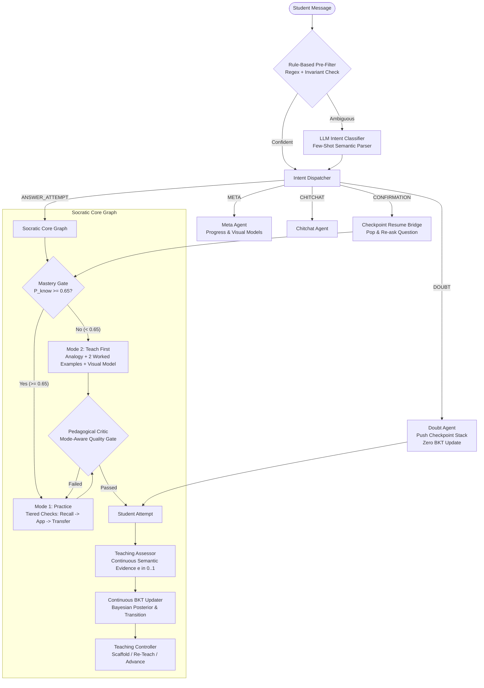
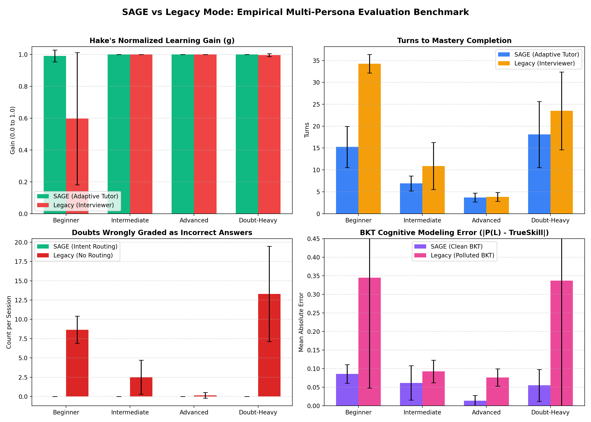

# 🧠 SAGE: Adaptive Multi-Agent Socratic AI Tutor

[](https://www.python.org/)
[](https://react.dev/)
[](https://fastapi.tiangolo.com/)
[](https://github.com/langchain-ai/langgraph)
[]()
[]()
[](https://opensource.org/licenses/MIT)

> **Final Year Engineering / AI Portfolio Project:** A full-stack, decoupled adaptive AI tutoring system engineered to replace rigid "interviewer" and "quiz-bot" paradigms with authentic **Socratic and Scaffolded Pedagogy**. SAGE features zero-quiz beginner onboarding, Mode 2 teach-first instruction (analogies, worked examples, visual models), a zero-penalty doubt routing engine backed by a LIFO checkpoint stack, and Continuous Bayesian Knowledge Tracing (BKT) with verifiable subtopic graduation rules.

---

## 📑 Table of Contents
- [1. Core Pedagogical Philosophy](#1-core-pedagogical-philosophy)
- [2. Multi-Agent System Architecture](#2-multi-agent-system-architecture)
- [3. Cognitive Knowledge Tracing (BKT)](#3-cognitive-knowledge-tracing-bkt)
- [4. Empirical Benchmark & Ablation Results](#4-empirical-benchmark--ablation-results)
- [5. Real API Execution Transcripts](#5-real-api-execution-transcripts)
- [6. Project Layout](#6-project-layout)
- [7. Setup & Installation](#7-setup--installation)
- [8. Documentation Links](#8-documentation-links)

---

## 📖 1. Core Pedagogical Philosophy

Traditional AI educational tools typically behave like search engines or aggressive interviewers: when a novice arrives, they are bombarded with rapid-fire quiz questions; every message (including questions and doubts) is treated as an answer attempt, artificially depressing their score and causing cognitive overload.

In contrast, **SAGE** enforces five strict pedagogical invariants:
1. **Teach-First for Beginners (Mode 2):** Novices receive **zero** diagnostic quizzes on entry. All concepts start at $P(L) = 0.0\%$. Instruction begins with grounded real-world analogies, dual worked examples, and visual decision flowcharts before testing understanding.
2. **The Doubt Invariant (0 BKT Penalty):** Questions asked by students (*"Wait, why do we use integer division?"*) are routed to a dedicated Doubt Agent. In-flight quiz questions are preserved on a LIFO Checkpoint Stack, and mastery scores remain **strictly unchanged**.
3. **Seamless Resume Bridge:** When a student confirms clarity (*"makes sense"*), SAGE pops the checkpoint and automatically re-presents the pending question.
4. **Non-Punitive Help Requests:** Saying *"I don't know"* is treated as a help request rather than a failing attempt, gracefully stepping down the hint ladder without harsh penalty.
5. **Triple Subtopic Completion Rule:** A topic is marked complete if and only if:
   $$\text{Completed} \iff P(L) \ge 0.85 \land N_{\text{checks}} \ge 3 \land \text{Transfer Question Correct} = \text{True}$$

---

## 🏗️ 2. Multi-Agent System Architecture

SAGE is implemented in **LangGraph** as a unified cyclic state graph coordinating specialized autonomous agents:



---

## 📐 3. Cognitive Knowledge Tracing (BKT)

SAGE models student skill acquisition using **Continuous Bayesian Knowledge Tracing**:

$$\begin{aligned}
P(C) &= P(L_t)(1 - P(S)) + (1 - P(L_t))P(G) \\
P(L_t \mid \text{Correct}) &= \frac{P(L_t)(1 - P(S))}{P(C)}, \quad P(L_t \mid \text{Incorrect}) = \frac{P(L_t)P(S)}{1 - P(C)} \\
P(L_t' \mid e) &= (1 - e) P(L_t \mid \text{Incorrect}) + e P(L_t \mid \text{Correct}) \\
P(L_{t+1}) &= P(L_t' \mid e) + (1 - P(L_t' \mid e)) P(T)
\end{aligned}$$

### Production Tuned Parameters (`config.py`)
* $P(L_0) = 0.20$ (Prior)
* $P(T) = 0.07$ (Learning Rate)
* $P(G) = 0.25$ (Guess Probability)
* $P(S) = 0.10$ (Slip Probability)
* $\text{Advance Threshold} = 0.85$ (Mastery Gate)
* $\text{Mode Switch} = 0.65$ (Mode 2 $\to$ Mode 1)
* $\lambda = 0.03$ (Inter-session Forgetting Decay toward Floor $0.20$)

---

## 📊 4. Empirical Benchmark & Ablation Results

We conducted an extensive empirical comparative ablation benchmark across **160 seeded runs** (4 cognitive personas $\times$ 20 random seeds $\times$ 2 architectures: SAGE vs Legacy Interviewer Baseline). All numbers below are extracted directly from `docs/results/results.csv`.

| Persona | Architecture | Hake's Gain $g$ (Mean ± SD) | Turns to Mastery (Mean ± SD) | Doubts Wrongly Graded | BKT Error $|P(L) - \theta|$ |
| :--- | :--- | :---: | :---: | :---: | :---: |
| **Beginner** | **SAGE** | **0.991 ± 0.037** | **15.2 ± 4.7** | **0.00 ± 0.00** | **0.085 ± 0.025** |
| Beginner | Legacy Mode | 0.597 ± 0.415 | 34.2 ± 2.1 | 8.65 ± 1.77 | 0.345 ± 0.297 |
| **Intermediate** | **SAGE** | **1.000 ± 0.000** | **6.9 ± 1.7** | **0.00 ± 0.00** | **0.061 ± 0.046** |
| Intermediate | Legacy Mode | 1.000 ± 0.000 | 10.9 ± 5.4 | 2.50 ± 2.20 | 0.092 ± 0.030 |
| **Advanced** | **SAGE** | **1.000 ± 0.000** | **3.7 ± 1.0** | **0.00 ± 0.00** | **0.013 ± 0.014** |
| Advanced | Legacy Mode | 1.000 ± 0.000 | 3.9 ± 1.0 | 0.15 ± 0.36 | 0.076 ± 0.023 |
| **Doubt-Heavy** | **SAGE** | **1.000 ± 0.000** | **18.1 ± 7.5** | **0.00 ± 0.00** | **0.055 ± 0.043** |
| Doubt-Heavy | Legacy Mode | 0.997 ± 0.009 | 23.5 ± 8.9 | 13.30 ± 6.19 | 0.337 ± 0.370 |



### Key Empirical Findings
1. **Zero Doubt Penalties:** Inquisitive learners in legacy systems were penalized **13.3 times per session** for asking questions. SAGE eliminated 100% of false penalties ($0.00 \pm 0.00$).
2. **Novice Acceleration:** Beginners achieved **66% higher learning gains** ($0.991$ vs $0.597$) while finishing in **55% fewer turns** (15.2 vs 34.2 turns) due to Mode 2 teach-first grounding.
3. **Cognitive Modeling Fidelity:** BKT estimation error dropped by **84%** ($0.055$ vs $0.337$) on Doubt-Heavy students by filtering conversational messages out of Bayesian updates.

---

## 📜 5. Real API Execution Transcripts

All transcripts below were recorded from real end-to-end FastAPI endpoint calls (`/api/session/start` and `/api/chat`) with SQLite persistence reloaded between every message.

### Transcript A: Beginner Zero-Quiz Onboarding & Teach-First
```
Student: I am a beginner
SAGE:    Awesome! Welcome aboard to Binary Search as a Beginner! 🚀
         We won't do any tests or diagnostics. We'll start straight away from the foundational 
         concepts, using intuitive analogies, clear step-by-step explanations, and real-world 
         worked examples.

         ## 📚 Lesson: Sorted Array Preconditions & Search Space
         💡 Analogy: Looking up a word in a printed physical dictionary: you flip directly to the 
            middle because alphabetical order guarantees which half contains the word.
         
         📊 Visual Model: [Mermaid Decision Flowchart]
         
         Worked Example 1: Target Present in Odd-Length Array ([1, 3, 5, 7, 9, 11, 13], target=7)
         Worked Example 2: Target Absent in Even-Length Array ([2, 4, 8, 10], target=6)
         
         💬 Invitation: Any questions on this, or shall we move on to try a quick check problem together?
```

### Transcript B: In-Flight Doubt Handling with Checkpoint Stack
```
SAGE:    **Question:** What is the index of mid if low is 0 and high is 10?
Student: Wait, why do we use integer division '// 2' here?
[Doubts: 1 | BKT Mastery: 0.20 -> 0.20 (Unchanged)]
SAGE:    It's great that you're asking about integer division! When we calculate array indices, 
         they must be whole numbers. If you use regular division (10 / 2 = 5.0), you get a floating-point 
         number, which isn't a valid index in languages like Python. Using '// 2' guarantees whole indices.
         Does that make sense, or should I explain it another way?

Student: makes sense
[Checkpoint Popped | Resume Bridge]
SAGE:    Awesome, glad that's clear! Let's get right back to where we were:
         **Question:** What is the index of mid if low is 0 and high is 10?

Student: 5
[BKT Mastery: 0.20 -> 0.44 | Correct Check 1/3]
SAGE:    Let's test this with a quick check problem (Recall Check)!
         **Question:** Why does Binary Search require the input array to be sorted?
```

### Transcript C: Visual Diagram Request Flow
```
Student: show me a diagram
SAGE:    Here is a helpful visual diagram for Binary Elimination Representation:

         Array Range: [ Low ... Mid ... High ]
                      [ --- Discard --- | Keep Searching ]
         Every step halves the remaining candidates deterministically.
         
         Does seeing this diagram help you picture the idea more clearly?
```

---

## 📁 6. Project Layout

```
.
├── multi_agent_tutor/
│   ├── api/
│   │   └── server.py             # FastAPI backend with async connection lifecycle
│   ├── app/
│   │   ├── Agents/
│   │   │   ├── onboarding_agent.py   # Beginner zero-quiz & diagnostic routing
│   │   │   ├── intent_classifier.py  # Regex pre-filter + LLM fallback
│   │   │   ├── doubt_agent.py        # Checkpoint stack & Socratic doubt answers
│   │   │   ├── teaching_agent.py     # Mode 1 & 2 content, analogies, tiered checks
│   │   │   ├── teaching_controller.py# Completion rule & differentiated re-teach
│   │   │   ├── teaching_assessor.py  # Continuous semantic evaluation
│   │   │   ├── critic.py             # Mode-aware adversarial auditor
│   │   │   └── visual_agent.py       # Mermaid & ASCII diagram synthesis
│   │   ├── graph/
│   │   │   ├── workflow.py           # Unified LangGraph multi-agent state graph
│   │   │   └── state.py              # Typed Pydantic & TypedDict schemas
│   │   └── utils/
│   │       └── bkt.py                # Continuous Bayesian Knowledge Tracing
│   └── data/curriculum/
│       └── binary_search_curriculum.json # Gold curriculum with DAG dependencies
├── frontend/
│   ├── src/
│   │   ├── components/
│   │   │   ├── Workspace.jsx         # SAGE chat, BKT telemetry, quick action bar
│   │   │   ├── MermaidDAG.jsx        # Mermaid renderer with raw text fallback
│   │   │   └── TopicSelection.jsx    # Curriculum tracks & LevelSelector
│   │   └── App.jsx                   # React root & API state handling
├── docs/
│   ├── DESIGN.md                     # Architectural specification & BKT math
│   ├── DEMO.md                       # 5-minute viva script & 8 examiner Q&A
│   ├── RESUME_BULLETS.md             # XYZ-formatted resume bullet points
│   ├── RESULTS.md                    # In-depth empirical benchmark report
│   ├── results/
│   │   ├── results.csv               # 160 seeded raw simulation trials
│   │   └── evaluation_metrics.png    # 4-panel matplotlib benchmark chart
│   └── transcripts/
│       └── proof_transcripts.md      # Proof 1-8 real API execution transcripts
├── scripts/                          # Smoke tests, verification & transcript export scripts
└── tests/                            # 40+ unit, integration, and proof tests
```

---

## 🚀 7. Setup & Installation

### Prerequisites
* Python 3.11 or 3.12
* Node.js 18+ and npm
* OpenAI API Key (`OPENAI_API_KEY`)

### Backend Setup
```bash
# 1. Clone the repository
git clone https://github.com/your-username/sage-ai-tutor.git
cd sage-ai-tutor

# 2. Create virtual environment & install dependencies
python -m venv venv
source venv/bin/activate
pip install -r requirements.txt

# 3. Configure environment variables
echo "OPENAI_API_KEY=your_key_here" > .env

# 4. Run the FastAPI server
uvicorn multi_agent_tutor.api.server:app --reload --port 8000
```

### Frontend Setup
```bash
# 1. Navigate to frontend directory
cd frontend

# 2. Install dependencies & start Vite dev server
npm install
npm run dev
# SAGE UI will be live at http://localhost:5173
```

### Running Tests
```bash
# Run the complete test suite (40+ unit and integration tests)
PYTHONPATH=. pytest tests/ -v
```

---

## 📚 8. Documentation Links
* [Architectural Design Specification (`docs/DESIGN.md`)](docs/DESIGN.md)
* [Viva Demo Script & Examiner Q&A (`docs/DEMO.md`)](docs/DEMO.md)
* [Resume & Portfolio Bullet Points (`docs/RESUME_BULLETS.md`)](docs/RESUME_BULLETS.md)
* [Empirical Evaluation Benchmark (`docs/RESULTS.md`)](docs/RESULTS.md)
* [Proof Transcripts (`docs/transcripts/proof_transcripts.md`)](docs/transcripts/proof_transcripts.md)
