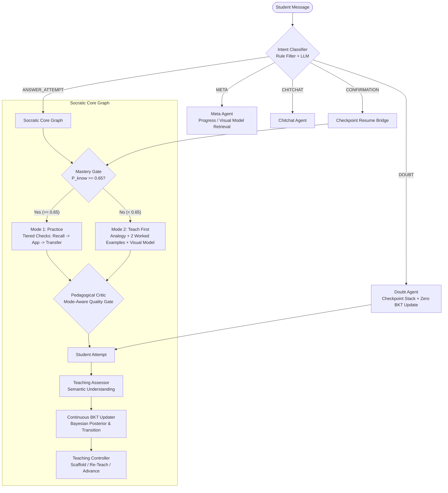

# SAGE: Architectural Design & Cognitive Modeling Specification

## 1. System Overview & Architectural Topology

SAGE is a full-stack, decoupled adaptive AI tutoring system designed to replace rigid "interviewer" or "quiz-bot" paradigms with authentic **Socratic and Scaffolded Pedagogy**. The architecture coordinates specialized LLM agents and deterministic cognitive state machines across a cyclic state graph.

---

## 2. Cognitive Modeling: Continuous Bayesian Knowledge Tracing (BKT)

### A. Core Mathematical Formulation
Standard BKT models student skill acquisition as a Hidden Markov Model with binary observations (Correct / Incorrect). SAGE implements **Continuous Bayesian Knowledge Tracing** to incorporate continuous evidence $e \in [0.0, 1.0]$ emitted by semantic LLM assessment (e.g. partial explanations, accurate reasoning with minor syntax slips):

1. **Probability of Correct Observation:**
   $$P(C) = P(L_t)(1 - P(S)) + (1 - P(L_t))P(G)$$

2. **Bayesian Posterior Update for Extremes:**
   $$P(L_t \mid \text{Correct}) = \frac{P(L_t)(1 - P(S))}{P(C)}$$
   $$P(L_t \mid \text{Incorrect}) = \frac{P(L_t)P(S)}{1 - P(C)}$$

3. **Continuous Evidence Interpolation:**
   $$P(L_t' \mid e) = (1 - e) \cdot P(L_t \mid \text{Incorrect}) + e \cdot P(L_t \mid \text{Correct})$$

4. **Latent Skill Transition:**
   $$P(L_{t+1}) = P(L_t' \mid e) + (1 - P(L_t' \mid e)) \cdot P(T)$$

### B. Configuration Parameters (`config.py`)
To prevent hyper-sensitive swings and guarantee about **4–6 correct check questions** for a novice to achieve mastery from scratch, SAGE defines the following empirically tuned parameters:

| Parameter | Symbol | Production Value | Pedagogical Rationale |
| :--- | :---: | :---: | :--- |
| **Initial Prior** | $P(L_0)$ | `0.20` | Baseline prior for unknown intermediate concepts. |
| **Transition Rate** | $P(T)$ | `0.07` | Stable learning rate; prevents single-question mastery jumps. |
| **Guess Probability** | $P(G)$ | `0.25` | Models 4-option multiple-choice or intuitive guessing. |
| **Slip Probability** | $P(S)$ | `0.10` | Forgiving allowance for typos or minor slips. |
| **Mastery Threshold** | $\tau_{\text{advance}}$ | `0.85` | Stringent threshold required for concept graduation. |
| **Mode Switch Gate** | $\tau_{\text{mode}}$ | `0.65` | Transition point from Mode 2 (Teach-First) to Mode 1 (Practice). |
| **Retention Floor** | $F_{\text{ret}}$ | `0.20` | Floor beneath which inter-session forgetting never decays. |
| **Forgetting Rate** | $\lambda$ | `0.03` | Exponential decay rate applied strictly between sessions. |
| **Remediation Cap** | $C_{\text{rem}}$ | `3` | Max re-teach cycles before offering scaffolding or forward advancement. |
| **Doubt Stack Depth** | $D_{\text{max}}$ | `3` | Maximum nesting depth for sub-doubts. |
| **Min Correct Checks** | $N_{\text{min}}$ | `3` | Strict prerequisite checks before advancing a subtopic. |

---

## 3. Intent Classification & Safe Routing Architecture

One of the most destructive failure modes in standard AI tutors is treating every student message as an evaluative quiz response. SAGE employs a **Two-Tier Intent Classifier**:

### Tier 1: Deterministic Rule-Based Pre-Filter
Executes in $< 1\text{ms}$ with zero token cost:
- **Pending Question Invariant:** If `pending_question` is `None`, the message can **never** be classified as `ANSWER_ATTEMPT`.
- **Doubt Trigger Patterns:** Messages matching `^(wait|why|how|what does|could you explain|i don't understand|can you clarify|\?)` are routed directly to `DOUBT`.
- **Confirmation Patterns:** `^(ok|got it|makes sense|understood|i see|sure|cool)$` are classified as `CONFIRMATION`.
- **Help Requests:** `"i don't know"`, `"no idea"`, `"not sure"` are routed to the scaffold/hint ladder without punitive BKT scoring.
- **Terse Answer Parsing:** When a question is pending, short regex matches (e.g. `^\d+$`, `^O\(.*\)$`, `^[A-D]$`, `^(true|false)$`) are correctly recognized as `ANSWER_ATTEMPT` rather than flagged as ambiguous.

### Tier 2: LLM Intent Classifier
If the pre-filter is uncertain, a lightweight classification prompt resolves nuances:
- **Mixed Messages (Attempt + Doubt):** e.g., *"Is mid equal to 4? But wait, why did we round down?"*
  - The doubt is extracted and answered first.
  - The tentative answer is cached and evaluated only after the student confirms understanding of the doubt.

---

## 4. Doubt Invariants & The Checkpoint Stack

SAGE guarantees that inquisitive students are never penalized for asking clarifying questions.

### The Doubt Checkpoint Lifecycle
1. **Push:** When a student asks a doubt while a tutor question is pending, the current state (`pending_question`, `concept_id`, `subtopic`, `bkt_snapshot`, `attempt_count`) is pushed to `doubt_state["checkpoint_stack"]`.
2. **Pedagogical Resolution:** `doubt_agent` provides a dedicated, Socratic explanation of the specific question asked, grounded in conceptual definitions.
3. **Clarity Verification:** The response concludes with an explicit checkpoint check: *"Does that make sense, or should I explain it another way?"*
4. **Pop & Resume:** Upon student confirmation (*"makes sense"*, *"got it"*), the checkpoint is popped from the stack.
5. **Resume Bridge:** SAGE presents a natural resume transition:
   > *"Awesome, glad that's clear! Let's get right back to where we were:*  
   > **Question:** *What is the index of mid if low is 0 and high is 10?"*
6. **BKT Invariant:** Throughout the entire doubt lifecycle, $P(L)$ remains **strictly bitwise identical**.

---

## 5. Pedagogical Strategy: Mode 1 vs Mode 2

### Mode 2: Teach First ($P(L) < 0.65$)
For students who report as beginners or whose concept mastery is below 0.65:
- **Zero-Quiz Initialization:** Beginners receive **zero** diagnostic test questions. All topics start at $P(L) = 0.0$.
- **Scaffolded Explanation Chunk:** Mode 2 presents:
  1. **Grounded Real-World Analogy:** (e.g. flipping open a dictionary to the middle page).
  2. **Visual Model:** Mermaid flowchart, ASCII range diagrams, or state trace tables.
  3. **Two Worked Examples:** One where the target is present; one where the target is absent and pointers cross.
- **Conversational Invitation:** Concludes with an invitation: *"Any questions on this, or shall we try a quick check problem together?"*

### Mode 1: Practice ($P(L) \ge 0.65$)
When the student demonstrates foundational understanding, the tutor switches to active Socratic problem solving:
- **Tiered Check Questions:**
  1. *Recall Check:* Fundamental definition or precondition.
  2. *Application Check:* Concrete trace through array values and pointer updates.
  3. *Transfer Check:* Novel variant (e.g. finding first occurrence in duplicates, searching descending array).
- **Completion Rule:** A topic cannot advance merely by crossing the 0.85 threshold. It requires:
  $$\text{Completed} \iff P(L) \ge 0.85 \land N_{\text{checks}} \ge 3 \land \text{Transfer Correct} = \text{True}$$
- **Differentiated Re-Teach Cycles:** If an attempt is incorrect, SAGE iterates through up to 3 differentiated modalities:
  - *Cycle 1:* Alternative analogy.
  - *Cycle 2:* Micro-step breakdown with concrete numbers.
  - *Cycle 3:* Visual execution trace table.
  - *Remediation Cap:* At cycle 3, offers an explicit scaffold or the choice to move forward.

---

## 6. Persistence & State Rehydration

All session states are persisted to SQLite/PostgreSQL across every turn:
- `doubt_state` (stack and audit log)
- `pending_question`
- `teaching_mode`
- `teaching_step`
- `subtopic_mastery`
- `misconceptions_log`
- `signals` and `visuals`

`rehydrate_state()` deserializes JSON columns into typed Pydantic models, ensuring zero state corruption across server restarts or database reloads.
