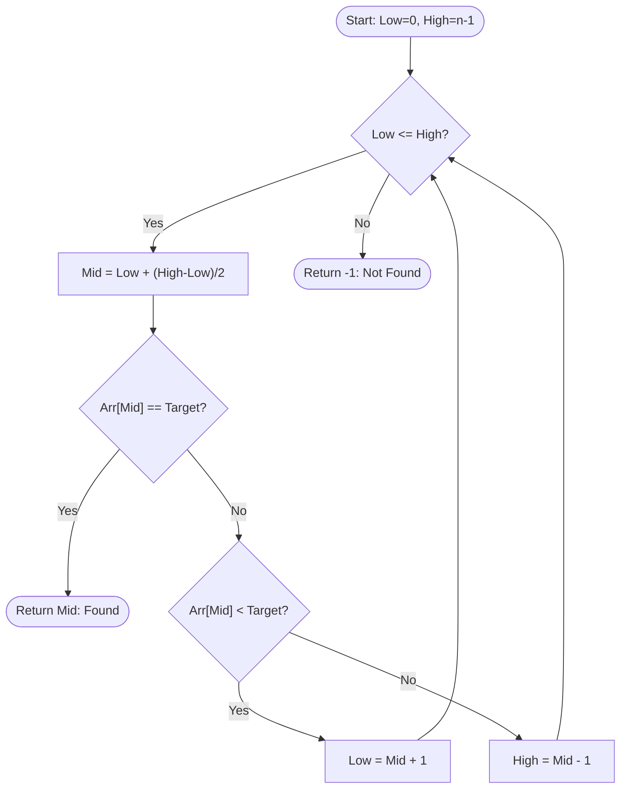

# SAGE: Real API Execution Transcripts (Proof 1-8)

> **System Verification:** All transcripts were recorded via real FastAPI endpoints (`/api/session/start` and `/api/chat`) with the SQLite database reloaded from disk between turns.

## Proof 1 Beginner

### Turn 0 - 🤖 **SAGE Tutor**

👋 Welcome to SAGE! I'm your interactive tutor, and I'm excited to explore **Binary Search** with you.

To make sure our lessons are tailored to your pace, how would you describe your current experience with this topic?

1. **Beginner**: Completely new (we'll start from scratch with step-by-step explanations, real-world analogies, and worked examples)
2. **Some knowledge**: I know the basics, but want to strengthen my intuition and problem-solving
3. **Comfortable**: Confident with core ideas, ready for tricky variants and deep algorithmic analysis

*(You can click a button or just reply naturally!)*

### Turn 1 - 👤 **Student**

I am a beginner

### Turn 1 - 🤖 **SAGE Tutor**

Awesome! Welcome aboard to **Binary Search** as a Beginner! 🚀

We won't do any tests or diagnostics. We'll start straight away from the foundational concepts, using intuitive analogies, clear step-by-step explanations, and real-world worked examples.

Feel free to ask any doubt at any point—there are no silly questions here!

---

## 📚 Sorted Array Preconditions & Search Space (Part 1/4: Intuition & Core Problem)

Understanding why monotonicity and sorted order are mandatory for binary elimination.

### Intuitive Mental Model
💡 **Analogy:** Looking up a word in a printed physical dictionary: you flip directly to the middle because alphabetical order guarantees which half contains the word.

---
💬 Any questions on this, or click **Continue** when you're ready to proceed!

---

## Proof 2 SomeKnowledge Diagnostic

### Turn 0 - 🤖 **SAGE Tutor**

👋 Welcome to SAGE! I'm your interactive tutor, and I'm excited to explore **Binary Search** with you.

To make sure our lessons are tailored to your pace, how would you describe your current experience with this topic?

1. **Beginner**: Completely new (we'll start from scratch with step-by-step explanations, real-world analogies, and worked examples)
2. **Some knowledge**: I know the basics, but want to strengthen my intuition and problem-solving
3. **Comfortable**: Confident with core ideas, ready for tricky variants and deep algorithmic analysis

*(You can click a button or just reply naturally!)*

### Turn 1 - 👤 **Student**

I know some

### Turn 1 - 🤖 **SAGE Tutor**

Diagnostic question 1 of 12

Why does Binary Search require the input array to be sorted?

### Turn 2 - 👤 **Student**

I don't know

### Turn 2 - 🤖 **SAGE Tutor**

No worries at all! Here's a small hint to point you in the right direction:

💡 It's completely normal to feel uncertain about concepts like binary search, so don't worry! Let's break it down together.

With that hint in mind, let's give the question another shot:

**Question:** Why does Binary Search require the input array to be sorted?

### Turn 3 - 👤 **Student**

Wait, why does the array need to be sorted first?

### Turn 3 - 🤖 **SAGE Tutor**

That's a great question! Understanding why the input array must be sorted for binary search is key to grasping how this algorithm works.

Binary search operates by repeatedly dividing the search interval in half. It begins by comparing the target value (the value you're searching for) to the middle element of the array. If the target is equal to the middle element, you've found it! If the target is less than the middle element, you can eliminate the right half of the array from consideration, and if it's greater, you can eliminate the left half.

Now, this elimination process relies on the array being sorted. If the array is not sorted, you cannot confidently decide which half to discard. For example, imagine you have the following unsorted array: [3, 1, 4, 2]. If you look at the middle element (which could be 4), and your target is 2, you wouldn't know whether to search left or right because the elements aren't in a predictable order. 

In contrast, if the array is sorted, say [1, 2, 3, 4], and you check the middle element (which is 3), you can clearly see that since your target (2) is less than 3, you can safely ignore everything to the right of 3. This is the essence of binary search: it relies on the order of elements to efficiently narrow down the search space.

This principle is well-documented in authoritative texts like "Introduction to Algorithms" by Cormen et al. and "Data Structures and Algorithms Made Easy" by Narasimha Karumanchi, which emphasize that the efficiency of binary search hinges on the sorted nature of the input array.

So, in summary, the requirement for a sorted array is what allows binary search to effectively halve the search space and find the target value quickly.

Does that make sense, or should I explain it another way?

### Turn 4 - 👤 **Student**

makes sense

### Turn 4 - 🤖 **SAGE Tutor**

Awesome, glad that's clear! Let's get right back to where we were:

**Question:** Why does Binary Search require the input array to be sorted?

---

## Proof 4 Mode1 QA

### Turn 1 - 👤 **Student**

The left half is discarded, so low becomes mid + 1.

### Turn 1 - 🤖 **SAGE Tutor**

Here is a challenge problem on Binary Search Fundamentals (Transfer Problem):

**Question:** Can Binary Search be used to find an element in a rotated sorted array like [4, 5, 6, 7, 0, 1, 2]? Briefly explain why or why not.

---

## Proof 5 Doubt Invariants

### Turn 1 - 👤 **Student**

Wait, why do we use integer division '// 2' here?

### Turn 1 - 🤖 **SAGE Tutor**

Great question! The use of integer division (often represented as `//` in programming languages like Python) in the context of binary search is crucial for determining the middle index of a given range.

When you're performing a binary search, you start with two pointers: `low` and `high`. These pointers represent the current segment of the array you're examining. To find the middle index, you want to calculate the average of `low` and `high`. However, since you're dealing with indices, you need to ensure that the result is also an integer.

Here's why we use integer division:

1. **Indices Must Be Whole Numbers**: Array indices are whole numbers (0, 1, 2, etc.). If you were to use regular division (like `/`), you could end up with a non-integer result. For example, if `low` is 0 and `high` is 10, the average would be `5.0` using regular division, but you need the index to be `5`, not `5.0`.

2. **Avoiding Floating Point Issues**: Using integer division ensures that you're working with exact integer values, which is especially important in programming where floating-point arithmetic can lead to precision errors. 

3. **Correct Middle Calculation**: In the binary search algorithm, the middle index is calculated as `mid = (low + high) // 2`. This effectively gives you the floor value of the average, which is what you want when determining the index to check in the array.

So, if `low` is 0 and `high` is 10, the calculation would be:

```python
mid = (0 + 10) // 2  # This results in 5
```

This means you will check the element at index 5 in your array. 

Using integer division is a simple yet effective way to ensure that you always get a valid index while performing the binary search, allowing the algorithm to function correctly and efficiently. Keep up the great work in understanding these concepts!

Does that make sense, or should I explain it another way?

### Turn 2 - 👤 **Student**

makes sense

### Turn 2 - 🤖 **SAGE Tutor**

Awesome, glad that's clear! Let's get right back to where we were:

**Question:** What is the index of mid if low is 0 and high is 10?

### Turn 3 - 👤 **Student**

5

### Turn 3 - 🤖 **SAGE Tutor**

**Verdict:** Correct! 🎯
Spot-on reasoning—you accurately demonstrated the core concept.

Let's test this with our next check problem (Recall Check):

**Question:** Why does Binary Search require the input array to be sorted?

---

## Proof 6 Diagram Request

### Turn 1 - 👤 **Student**

show me a diagram

### Turn 1 - 🤖 **SAGE Tutor**

Here is a helpful visual diagram for **Binary Search Algorithm Flowchart**:



*Standard Binary Search decision flow showing the 3-way branch at each step.*

Does seeing this diagram help you picture the idea more clearly?

---

## Proof 8 Returning Student

### Turn 0 - 🤖 **SAGE Tutor**

👋 Welcome back! Last time we finished work on **Binary Search Fundamentals** and reached 85% mastery. Ready to pick up right where we left off, or would you like a 2-minute refresher?

---

